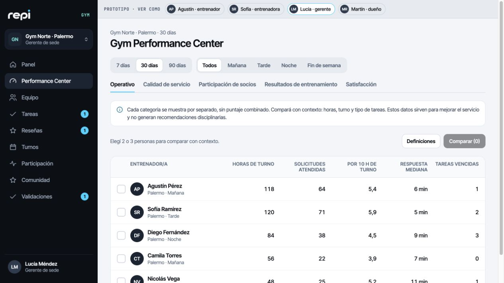
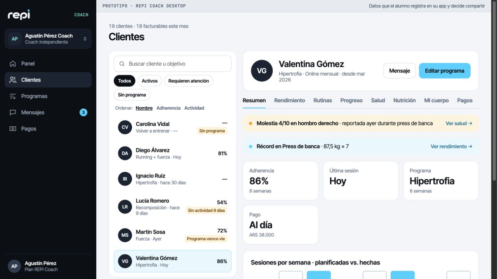
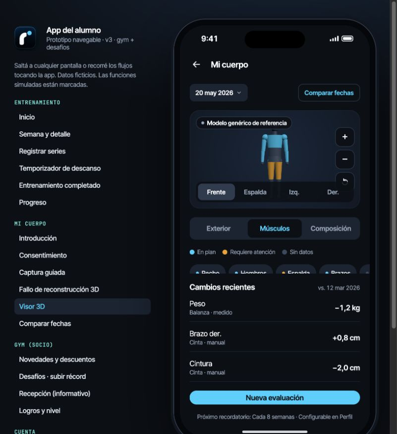

# REPI — Análisis del ZIP y estado del handoff

25 de octubre de 2026 · Concepto 2 preservado · Auditoría del contenido entregado, sin modificación del producto.

## Dictamen

El ZIP aporta un handoff de diseño amplio y útil para desarrollar REPI: app de alumno, escritorios Coach y Gym, panel Admin, motion, marca, modelos conceptuales e inventarios. **No contiene una aplicación de producción ni acredita que sus funcionalidades estén terminadas.** Hay interacción local real, almacenamiento local limitado y numerosas simulaciones; también hay defectos que afectan la demostración.

Sí permite redactar un máster prompt integral y accionable. No permite declarar cerradas todas las decisiones comerciales, de permisos, de alcance de lanzamiento ni de Body Intelligence. El [máster prompt](02_MASTER_PROMPT_CLAUDE_CODE.md) integra lo comprobado y exige resolver las decisiones que afectan cada entrega, sin frenar el trabajo independiente ni inventar aprobaciones.

La enumeración de funciones en nuestras conversaciones **no es exhaustiva**. Por indicación expresa del usuario, Claude Code deberá descubrir todas las funcionalidades adicionales presentes en el handoff que reciba. Las 93 entradas actuales son un punto de partida; no un techo, ni una autorización para agregar capacidades sin evidencia.

## Fuentes y confiabilidad

- ZIP adjunto recuperado de «Alumnos - Entrenador - Pricing x socio»; es idéntico byte a byte al archivo homónimo de Downloads. SHA-256: `112519f221cb6beec579fdff10a5681bbb0fbd3405a443635aacd6b83dd9cae5`.
- [Fuentes extraídas](../fuentes/REPI_COMPLETE_DESIGN_HANDOFF/README.md), con 89 archivos conservados íntegramente.
- [Investigación de Body Intelligence](../fuentes/Investigacion_Tecnica_REPI_Body_Intelligence.pdf), 48 páginas, extraídas completas. Se inspeccionaron visualmente páginas relevantes y se contrastaron afirmaciones seleccionadas con fuentes primarias; no se ejecutó validación científica.
- Mensajes humanos recuperados de la conversación referenciada: Gym por socio a menor precio unitario por volumen, misma app con modalidades, escritorio para piso/remoto/gestión, seguimiento y reviews sin acceso gerencial al chat privado. La herramienta devuelve referencias opacas para las respuestas previas del asistente: no se reconstruyó ni inventó ese contenido.
- El ZIP también admite que parte de su historia se reconstruyó desde memoria. “Aprobado” dentro del paquete no equivale automáticamente a una aprobación humana verificable.

La revisión incluyó los documentos 00–23, README, checklist, manifest, JSON, CSS, el brief original y el handoff anterior; ocho HTML, tres JS y referencias de assets. Se abrieron ocho prototipos, se recorrieron 18 accesos móviles y se probaron flujos seleccionados. Detalle, límites y evidencia: [código](../evidencia/AUDITORIA_CODIGO.md), [requisitos/diseño](../evidencia/AUDITORIA_REQUISITOS_DISENO.md), [navegador](../evidencia/VERIFICACION_EN_NAVEGADOR.md), [Body Intelligence](../evidencia/BODY_INTELLIGENCE_AUDIT.md).

## 1. Qué contiene realmente

```text
REPI_COMPLETE_DESIGN_HANDOFF/
├── 00_EXECUTIVE_SUMMARY.md … 23_DESIGN_IMPLEMENTATION_MAP.md
├── README.md, CHECKLIST.md, MANIFEST.json
├── features.json, screens.json, navigation.json
├── roles-permissions.json, implementation-backlog.json
├── design-tokens.json
├── design-tokens/     JSON duplicado + CSS parcial
├── assets/
│   ├── brand-original/  imagen maestra, recortes y brief original
│   ├── icons/ y logos/  PNG y capas de motion
│   └── previous-handoff/  handoff v3 con partes superadas
└── prototypes/
    ├── REPI App Alumno v3.dc.html
    ├── REPI Desktop Coach.dc.html
    ├── REPI Desktop Gym.dc.html
    ├── REPI Admin.dc.html
    ├── REPI Motion Intro.dc.html
    ├── support.js, repi-shared.js, assets/
    └── legacy/  Alumno v1, Alumno v2 y Escritorio incompleto
```

Son 6.074.127 bytes descomprimidos. No incluye proyecto productivo con package manifest/lockfile, backend, migraciones, autenticación, pruebas, CI, variables de entorno o despliegue. La existencia de otro repositorio fuera del ZIP no se tomó como implementación de este archivo.

| Inventario | Comprobación |
|---|---|
| 93 funcionalidades | 63 prototipo, 6 parciales, 22 sin diseño, 1 mockup y 1 diseñada. El resumen omite la última categoría y sus subtotales suman 92 |
| 97 entradas de pantalla | 73 prototipo, 1 mockup, 2 conceptos, 2 parciales, 19 sin diseño. Incluye tabs, modales, overlays y conjuntos de flujos; no son 97 páginas productivas |
| 74 entradas “diseñadas” | Es un conteo documental; 48 desktop + 26 mobile, con showcase de intro incluido |
| 31 entradas de motion | 24 declaradas implementadas, 2 conceptos alternativos, 5 especificadas. El error del runtime impide acreditarlas todas como funcionales |
| 25 archivos en assets/ | 22 PNG y 3 Markdown; no 25 imágenes distintas |
| 29 archivos bajo prototypes/ | 8 HTML, 3 JS y 18 PNG; incluye copias y legacy |
| Cobertura de aceptación | 33 funcionalidades con criterio “—”; 51 pantallas con estados “—” |
| Brechas publicadas | 24, pero ni “21 diseños faltantes” ni “10 abiertos” son listados exhaustivos |

`F-RC-01..05` aparece como un único ID inexistente en `screens.json`; debe expandirse a los cinco IDs. Los dos JSON de tokens son idénticos. Las referencias locales literales de assets existen. El mapa de implementación contiene 77 filas y omite las 20 SCR-N; no es un router.

## 2. Código, navegación y persistencia

Los `.dc.html` son Design Components: plantillas con `x-dc`, `sc-if`, `sc-for`, expresiones y CSS inline. `support.js` interpreta/compila la lógica y monta React 18.3.1/ReactDOM desde CDN; declara Babel para cargas condicionales. El visor importa Three.js 0.160.0. Se usan Inter Tight y JetBrains Mono desde Google Fonts. Hay Web Animations API, SVG y ResizeObserver.

La navegación cambia variables de estado (`screen`, tabs, pasos y modales). Las rutas `/app/...`, `/w/:orgId/...` y `/admin/...` son propuestas documentales. No existe router productivo, historial de navegación interno o protección por URL. Cambiar Coach↔Gym carga otro HTML; la barra de personas del Gym es una herramienta de demostración.

| Capa | Qué hace | Qué no acredita |
|---|---|---|
| Estado de componente | Edición de rutinas, series, chat, turnos, tareas, pagos, preferencias | Persistencia, colaboración entre usuarios, autorización o sincronización |
| localStorage | Posts, desafíos, catálogo, intentos/notificaciones de Gym; marca de intro vista | Base de datos por organización o acceso seguro |
| IndexedDB | Videos de prueba de desafíos | Subida a servidor ni sesiones offline |
| Evento storage | Actualizaciones entre pestañas del mismo origen/navegador | Multiusuario, otros dispositivos, push remoto |
| Fetch del runtime | Carga HTML/componentes/dependencias | API de entrenamiento, pagos, identidad o BI |

No se encontraron APIs de negocio, SDK de pagos, autenticación, WebSocket o service worker de aplicación. Carga de fuentes y CDN sí implica red; “sin backend” no significa que el prototipo funcione totalmente desconectado.

## 3. Pantallas y funcionalidad por superficie

| Superficie | Aporte verificable | Falta para producto |
|---|---|---|
| Alumno v3 | Inicio, semana, sesión, descanso, resumen, progreso, mensajes, perfil, privacidad, BI, Gym/noticias/desafíos/catálogo/logros/notificaciones | Sesiones persistidas, offline real, auth, datos calculados desde historial, chat remoto, captura BI, relación dual, reseñas del socio, salud/nutrición/check-in |
| Coach | Panel, clientes split view, ocho pestañas, constructor, biblioteca de 15 ejercicios, chat y cobros manuales de demo | CRUD/invitaciones, biblioteca completa con medios, versiones/copias, programación avanzada, calendario/CSV, persistencia, consentimiento conectado y pagos reales |
| Gym entrenador | Mi turno, cola, ficha institucional, notas, edición con motivo, traspasos, desempeño | Servidor, concurrencia, atribución verificable, persistencia, permisos, reglas de trabajo remoto y fuera de turno |
| Gym gerente/dueño | Panel, cinco categorías de Performance Center, equipo, tareas, reviews, turnos, participación, comunidad, validaciones, sedes, facturación y configuración | Métricas provenientes de eventos, scopes coherentes, circuito de reseña completo, contratos reales, permisos ejecutables |
| Admin | Clientes, contrato editable, calculadora de precios, cobros, dashboard, planes estáticos | Persistencia, snapshots, altas sin error, planes editables, proveedor, conciliación, fiscal, flags/soporte/operación |
| Motion | Tres intros, modos regular/reducido/lento, animaciones locales | Resolver lifecycle; verificar cada motion y límite temporal; Club/pagos/háptica siguen sin implementación |
| Legacy | Historia de v1→v2→v3, evolución de BI/motion | No usarlos para restaurar cuotas Gym, permisos o navegación retirados; escritorio legacy sin lógica |

La ficha Coach contiene Resumen, Rendimiento, Rutinas, Progreso, Salud, Nutrición, Mi cuerpo y Pagos. Que muestre salud o comidas ficticias no resuelve cómo las carga y autoriza el alumno. El Gym ofrece operación y gestión; no una interfaz que permita al gerente entrar en la app privada del socio.

## 4. Diseño Concepto 2 y assets

**Conservar Friendly Performance**, el wordmark `repi` y su isotipo exactos, punto cian y “Cada repetición cuenta.” La imagen maestra y PNG originales mandan sobre una reinterpretación. No existe vector aprobado: el logo no debe recrearse escribiendo “repi” con Inter Tight.

Paleta base: navy `#0B0F14`, `#1A2433`, `#2D3B4F`; cian `#00D1FF`; turquesa `#5DE6D8`; blanco `#F8FAFC`. Alumno oscuro; escritorios claros con sidebar oscura. Los tokens agregan superficies claras, bordes, chips semánticos, radios y escalas; el CSS no exporta el sistema entero. Los componentes viven inline: hace falta una biblioteca reutilizable.

Hay botones, tabs/segmentados, chips, formularios, steppers, KPI, tablas, split view, barras, sheets/modales/toasts, gráficos, cronómetro, visor y stickers. Faltan versiones de producción con estados completos, semántica, foco y teclado. No hay archivos de fuentes locales, vector validado, fotografías/videos reales de ejercicios, modelos 3D exportados ni familia final de trofeos.

Se verificaron los 40 PNG físicos del paquete: representan 20 hashes distintos, con copias en assets, prototipos y legacy. Resoluciones, canales, tamaños y duplicados están en el [inventario de assets](../evidencia/ASSETS_VERIFICADOS.md).

La intro aprobada según el log es **1a “El punto”**. No confundir ese nombre con el **Concepto 2 de identidad**: son decisiones diferentes. La intro regular está descrita como 520 ms en tokens y ≤500 ms en aceptación; hay que reconciliarlo. Primer inicio saltable; ninguna animación debe bloquear el registro ni reiniciarse al volver de otra app.

La maqueta móvil usa un teléfono fijo de 414 px y contenido 390×844; no demuestra responsive real. Coach/Gym tienen navegación completa/rail/drawer; Admin sólo completa/rail y no cumple el drawer declarado. La verificación futura debe cubrir 375, 390, 430, 768, 1024, 1280, 1440 y 1920; este informe no afirma haber hecho esa matriz completa.

## 5. Defectos concretos que no deben heredarse

| Prioridad | Hallazgo | Evidencia principal |
|---|---|---|
| Alta | Callback de actualización recibe un argumento, componentes esperan dos: error recurrente y motion interrumpido | `support.js:1013`; `VERIFICACION_EN_NAVEGADOR.md` |
| Alta | “Guardado” sin persistencia de sesiones | Alumno v3:195, 1222–1240, 1491 |
| Alta | Elegir Piernas inicia ejercicios Torso A | Alumno v3:929, 1309; prueba aislada |
| Alta | Asignar a dos clientes comparte programa pese a prometer copias; fecha no persistida | Coach:326, 385, 518–520 |
| Alta | Admin crea objeto pero falla al abrirlo por snapshot anterior | Admin:271,310; navegador y consola |
| Alta | Captura/calidad/cifrado/reconstrucción BI simulados; “ajustado” sólo cambia etiqueta | Alumno v3:1387–1406,1553 |
| Alta | Medidas compartidas al inicio contradicen privacidad por defecto; grants no sincronizan con Coach | Alumno v3:942–943; Coach seeds independientes |
| Alta | Publicación llega a la otra pestaña pero no refresca emisora hasta recarga | Evidencia AX; posible doble instancia del store |
| Media | Error de localStorage puede producir éxito falso y pérdida de borrador | repi-shared.js:33; Gym:1307 |
| Media | Reseña retirada sigue contando; períodos escalan seeds en vez de consultar fechas | Gym:1003–1006,1388–1391 |
| Media | Eliminar BI/reset comunidad no elimina todos los datos o blobs | Alumno:1576; repi-shared.js:36–44 |
| Media | “Máximo” en Admin es actual×1,04; promedio no es diario; cambios alteran históricos | Admin:253,326,354 |
| Media | Campana de Progreso abre Mensajes | Alumno:330 |
| Media | Switches/checkboxes sin teclado, comparador sin alternativa, modales sin foco completo | Auditoría C23–C24 |
| Media | Videos sin límites robustos; aprobación de intento puede anunciar récord aunque no mejore | Auditoría C19 |

La auditoría detallada registra 26 hallazgos estáticos, más el hallazgo de lifecycle confirmado en navegador. Esto no es una lista exhaustiva de bugs de producción: no hay producto de producción para validar todavía.

## 6. Contraste con lo pedido para REPI

**Coach y Gym.** La expansión está claramente incorporada. Debe mantenerse una identidad y motor compartidos, relaciones independientes y experiencias por rol. No reducir REPI al alumno móvil. Falta fijar una experiencia remota Gym y su política de turnos; escritorio Coach independiente no la sustituye automáticamente.

**Managers y reviews.** La gestión puede ver métricas operativas, contexto y satisfacción, sin chats privados ni notas personales. Hay contradicciones de sede vs gym completo y de resultados individuales vs agregados. La captura de reseña del alumno fue retirada de otra maqueta y no migrada a v3: el circuito completo falta. Los umbrales n=5/n=10 y el método de rango estadístico no están cerrados.

**Repi Club.** La comunidad Gym ya aporta noticias, descuentos, desafíos, videos, catálogo y logros. El Club amplio —feed, reacciones, comentarios, rankings, trofeos y moderación— está especificado sin diseño. No deben confundirse ni excluirse funciones nuevas que aparezcan en un handoff ampliado.

**Pagos.** Separar cobros coach→cliente, suscripción Coach/Gym→REPI y cuotas gym→socio fuera de REPI. El catálogo de recepción es informativo. Los valores ARS 700, tramos 450/380/320, mínimo 150.000, BI 60 y descuento anual son demo/hipótesis. Falta resolver elegibilidad facturable, agregación temporal, tramos, corte, prorrateo, impuestos, proveedor y cambios efectivos. Un toast o una marca de “pagado” no cobra dinero.

**Body Intelligence.** Hay buen trabajo de UX para opcionalidad, fuente de datos, fallback, modo genérico y “Datos insuficientes”. No existe cámara real, reconstrucción personal ni inferencia validada. El PDF aporta arquitectura y experimentos; sus snippets no son implementación lista. Contradice privacidad con permisos DEFAULT TRUE; anuncia RLS sin políticas; su fitter ignora perímetros; mezcla taxonomías de regiones y usa afirmaciones de validación no ejecutada. Se verificaron licencias y documentación seleccionadas: no trasladar cifras de costo/precisión/latencia como garantías. Detalle y enlaces primarios en el informe BI.

## 7. Qué falta para un handoff completo

1. Matriz consolidada y abierta: fuente, decisión, pantalla, acción, entidad, permiso, estado real, dependencia y aceptación para toda función, incluidas nuevas.
2. Diseños/contratos para auth, invitación, relación dual, reseña del socio, salud/nutrición/check-in, offline/conflictos, biblioteca CRUD, calendario/CSV, notificaciones, checkout y Club.
3. Decisiones de facturación, scopes/grants, métricas/reviews, retención/edades y alcance del experimento BI.
4. Arquitectura ejecutable, identidad, persistencia, autorización en servidor, versionado, almacenamiento privado, operaciones y recuperación.
5. Datos y APIs coherentes que conecten alumno, Coach, Gym y Admin; eliminar cálculos/constantes de demo fuera de modo DEMO.
6. Assets de producción/licencias, responsive, accesibilidad, motion funcional y comparación visual con Concepto 2.
7. Backlog descompuesto, pruebas de punta a punta y evidencia por requisito. La hoja de ruta propuesta no autoriza descartar Gym/chat/expansiones para declarar completo un MVP.

El [registro de decisiones](03_DECISIONES_Y_FALTANTES.md) organiza los bloqueos. La auditoría conserva las fuentes y ofrece un prompt de ejecución que permite avanzar con lo definido, manteniendo visibles las decisiones abiertas y el alcance adicional que Claude Code descubra.

## 8. Capturas reales de la revisión

Estas capturas documentan la interfaz exportada, no una implementación nueva. Los valores visibles son datos de demostración.






